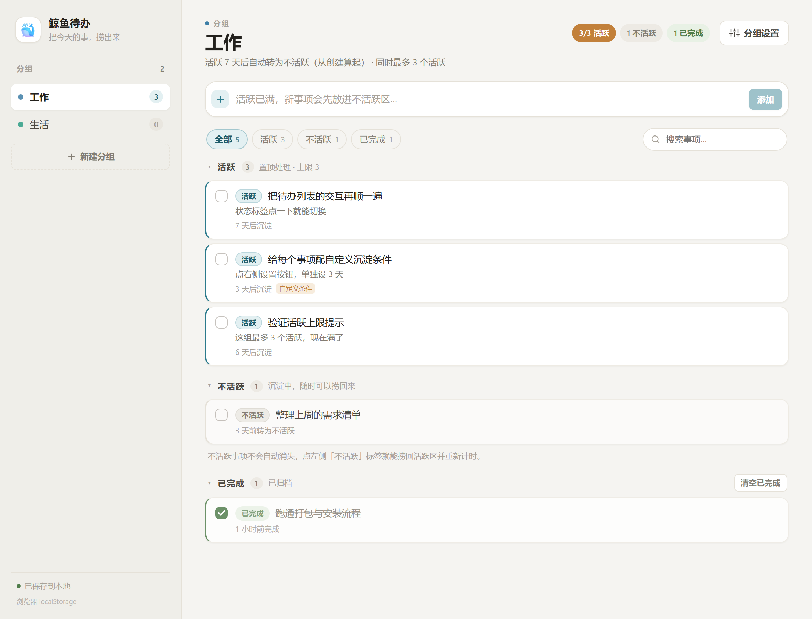
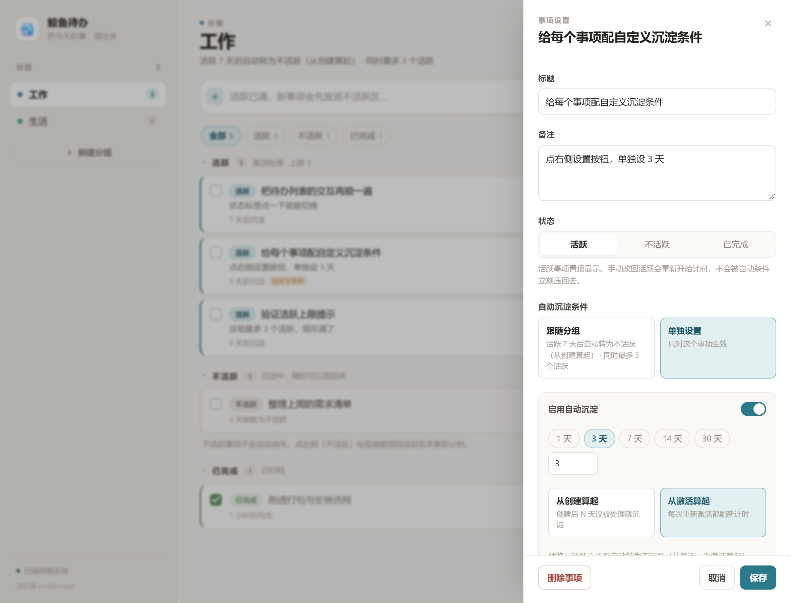
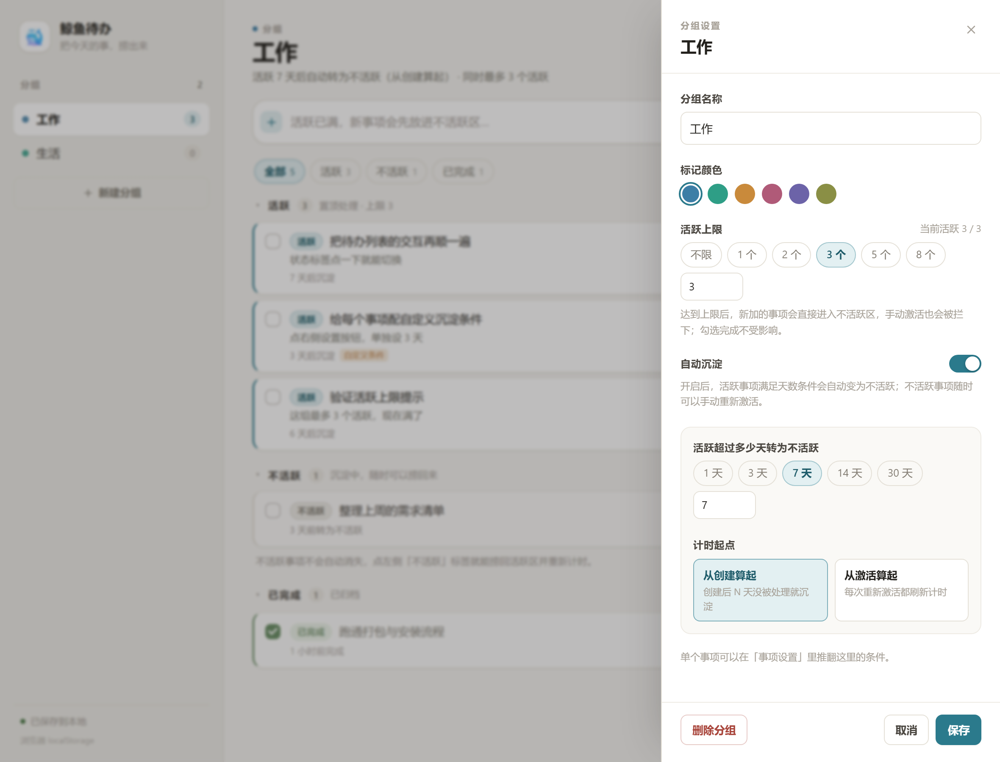

# 鲸鱼待办 · WhaleTodo

> 分组式待办清单。活跃的事永远置顶，到期没动就自动「沉淀」成不活跃——不占视线，也不丢。

一个 Windows 桌面应用（Electron + React + TypeScript），数据完全存在本地，不联网、不注册。



**English**: WhaleTodo is a group-based todo desktop app. Each task has three states — active, inactive (sunk) and done. Groups can auto-sink stale active tasks after N days, cap how many active tasks they allow, and every task can also carry its own rule. All data stays in a local JSON file.

## 下载 / 在线试用

- **下载安装包**：见 [Releases](https://github.com/wafernm-crypto/whaletodo/releases) 页，推荐 `鲸鱼待办-*-win.zip`（解压即用，不需安装）
- **网页版试用**：<https://wafernm-crypto.github.io/whaletodo/>（数据只存在浏览器 localStorage 里）

系统要求：Windows 10 / 11（x64）。macOS 与 Linux 暂未构建。

> 应用没有代码签名证书，首次运行 Windows 可能提示「已保护你的电脑」，点「更多信息 → 仍要运行」即可。

## 为什么做这个

常见待办软件只有「完成 / 未完成」，久了列表会变成一堵墙。WhaleTodo 多了一层**活跃度**：

- **活跃**：现在真的要处理的事，永远在最上面
- **不活跃**：暂时不想做、但不想删的事，自动沉到下面
- **已完成**：归档区，可折叠、可一键清空

再给每个分组配一条「自动沉淀」规则 —— 比如活跃超过 7 天就沉下去。这样置顶区不会越堆越多，同时没有任何事被悄悄删掉。

## 功能

- **分组**：新建、重命名、换颜色、删除；侧栏显示每组活跃数
- **事项**：标题 + 备注，回车即添加；双击标题或点铅笔行内编辑
- **三种状态**：点事项左侧的状态标签就能在「活跃 / 不活跃」之间手动切换；勾选框负责完成
- **自动沉淀**：每组可设「活跃超过 N 天自动转不活跃」，计时起点可选「从创建算起」或「从最近一次激活算起」，也能整组关闭
- **活跃上限**：每组最多允许 N 个活跃事项；满了之后新事项自动进不活跃区，手动激活会被拦下并提示
- **事项级条件**：单个事项可以覆盖分组的规则，单独设天数和计时起点，或直接关掉自动沉淀
- **手动激活会重新计时**：把沉下去的事捞回来，不会下一分钟又被规则压回去
- **排序**：区块内上移 / 下移
- **搜索 + 状态筛选**
- **可靠性**：原子写入 + 备份；关窗瞬间同步落盘；关软件期间到期的规则下次启动自动补算
- **深浅色**跟随系统

| 事项设置 | 分组设置 |
| --- | --- |
|  |  |

## 数据与隐私

```
%APPDATA%\WhaleTodo\data.json       主数据
%APPDATA%\WhaleTodo\data.bak.json   上一次保存的备份
```

- 纯本地 JSON，应用不发任何网络请求
- 侧栏底部会显示数据文件的完整路径
- 换机器、备份、迁移，拷这一个文件就够
- 旧版本数据（schema 1）会在启动时自动升级到 schema 2

## 开发

需要 Node.js 18+（推荐 20）和 npm。

```bash
npm install          # 安装依赖
npm run dev          # Electron + Vite 热更新
npm run preview      # 只起静态预览服务（http://127.0.0.1:4178），浏览器里调试界面
npm run build:web    # 类型检查 + 构建前端到 dist/
npm start            # 用 dist/ 启动 Electron
```

### 技术栈

- **Electron 33** 负责窗口与本地文件读写（`contextIsolation` + 沙箱 preload，只暴露读写能力）
- **React 18 + TypeScript + Vite** 负责界面，没有 UI 框架、没有状态库，样式是手写 CSS
- **领域层与平台无关**：`src/core` 是纯 TS（模型、规则引擎、存储接口），可以直接搬去移动端

### 目录结构

```
electron/
  main.mjs         主进程：窗口、IPC、原子写 JSON、关窗同步保存
  preload.cjs      只暴露 load / save / saveSync / location
src/
  core/            纯 TS 领域层
    types.ts       Group / Task / GroupRule 数据模型
    model.ts       工厂、默认值、脏数据归一化
    rules.ts       自动沉淀规则引擎（纯函数，传 now 即可测）
    storage.ts     存储接口 + 桌面 / 浏览器两种实现
  state/store.tsx  reducer、规则补算、防抖落盘
  ui/              界面组件
  App.tsx          活跃 / 不活跃 / 已完成 三分区编排
scripts/           开发、打包、截图验收脚本
build/             图标资源与生成脚本
```

### 界面验收工具

`scripts/ui-shot.mjs` 用 Chrome DevTools Protocol 打开页面、注入测试数据、模拟点击并截图，不需要 Electron：

```bash
node scripts/serve.mjs 4178          # 另开终端
node scripts/ui-shot.mjs --url http://127.0.0.1:4178/ --seed scripts/seed.json \
  --out build/ui.png --scale 2
node scripts/ui-shot.mjs --url http://127.0.0.1:4178/ --seed scripts/seed.json \
  --out build/panel.png --click '.task:nth-child(2) .task__actions .icon-btn:nth-child(4)'
```

勾选框里的「勾」是纯 CSS 画的（`translate(-50%, -77%) rotate(-45deg)`），改动尺寸后可以用 `scripts/measure-check.py` 量回像素级偏移。

## 打包发布

本地：

```bash
npm run dist    # 产出 Setup.exe / 免安装 exe / zip 到 release/
```

CI：[`.github/workflows/release.yml`](.github/workflows/release.yml) 会在推送 `v*` 标签时自动构建并把产物挂到 Release：

```bash
git tag v0.2.0
git push origin v0.2.0
```

构建细节：

- `scripts/prepare-dist.mjs` 会把 Electron 的 `dist` 复制一份，用 rcedit 写入鲸鱼图标和中文产品信息，打包时 electron-builder 直接用它（`.electron-dist/`，默认不入库）
- `package.json` 里 `win.signAndEditExecutable: false` 是有意为之：这样打包不需要下载 winCodeSign 签名工具链，图标改由上面的脚本负责
- 主分支每次推送还会构建网页版并发布到 GitHub Pages（[`.github/workflows/pages.yml`](.github/workflows/pages.yml)）

## 已知问题

- **没有代码签名**：Windows SmartScreen 会提示未知发布者，属正常现象
- **只构建了 Windows**：Electron 本身跨平台，但还没做 macOS / Linux 的构建配置与测试
- **NSIS 安装包依赖 `%TEMP%`**：如果从受限环境（比如某些受限启动器）直接启动 `Setup.exe`，会报 `Error writing temporary file`；从资源管理器双击，或直接用 ZIP 版即可
- 事项暂不支持拖拽排序，只能用上移 / 下移按钮

## 路线图

1. 桌面端打磨：拖拽排序、快捷键、导入导出、开机自启、自动更新
2. 移动端：复用 `src/core`，用 Capacitor 打包，只替换 `storage.ts`
3. 数据同步：字段已预留 `id` / `updatedAt` / `statusChangedAt`，按「最后写入者胜」合并；需要时把硬删除改成软删除（`deletedAt`）

## 贡献

欢迎 issue 和 PR。开始之前：

```bash
npm install
npm run dev
```

提交前跑一遍 `npm run build:web`（包含 `tsc --noEmit`）。界面改动建议附截图，最好用上面的 `ui-shot.mjs` 出图，方便对比。

## 许可证

[MIT](LICENSE)
